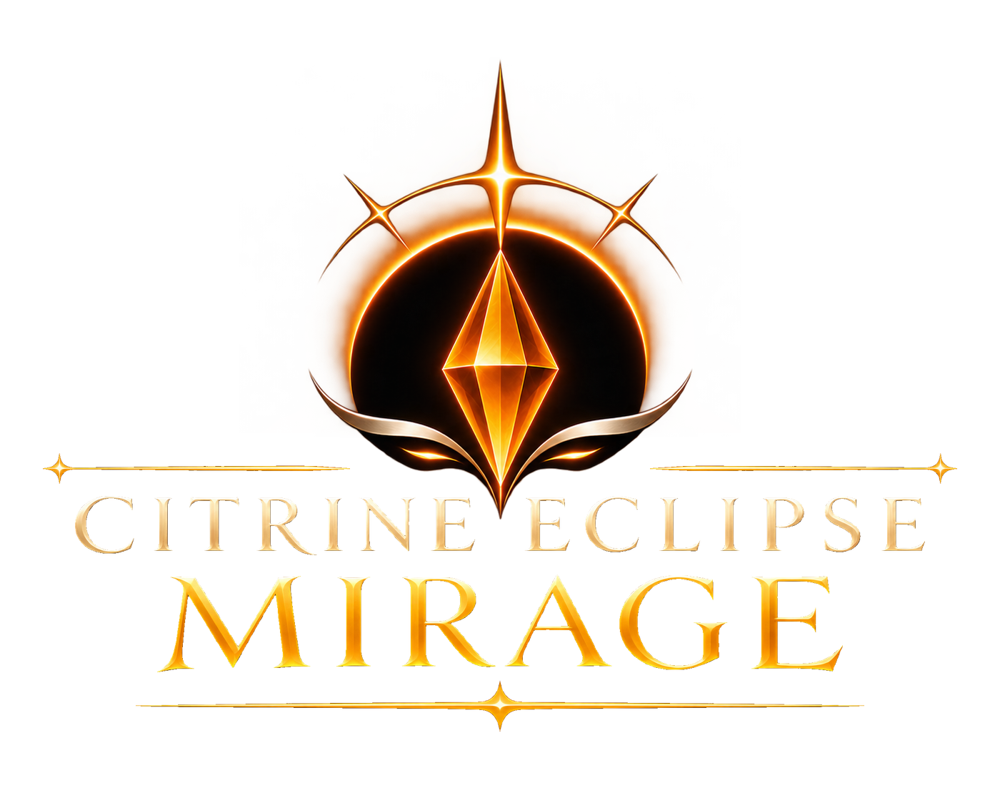

# Citrine Eclipse Mirage

 

A Windows-native C++ utility library focused on compatibility, maintainability, and controlled changes.

## Overview

Citrine Eclipse Mirage provides auxiliary routines and shared components for Windows-based applications. It is a supplementary dynamic-link library rather than a standalone application.

## Project history

See the [changelog](CHANGELOG.md) for the recorded GitHub development timeline and imported source history. A merged PR does not constitute a published release.

## Development

Read the [development instructions](docs/DEVELOPMENT.md), [project governance](GOVERNANCE.md), and [contribution workflow](docs/GITHUB_WORKFLOW.md).

Source QA, portable tests, Windows/MSVC native acceptance, Golden validation and application/game acceptance are distinct evidence classes.

## Building

See the [development instructions](docs/DEVELOPMENT.md) for build and test commands.

