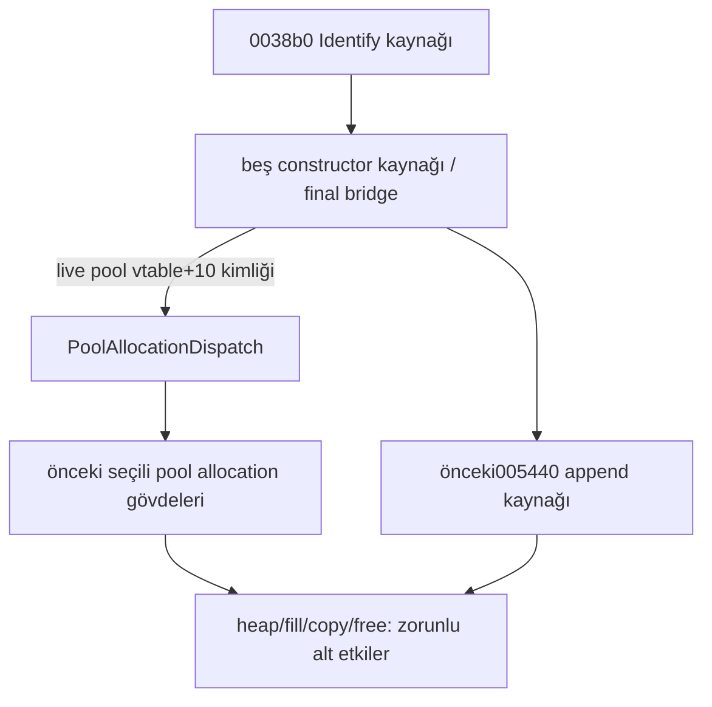

# N27 — Beş node constructor kaynak gövdesi

27 Ekim 2026. `node_constructors.hpp/cpp`, beş normal constructor gövdesini ve `RecoveredNodeConstructorEffects` üzerinden beş final sağlayıcı bağlantısını ekler. `NativeNodeIdentifyEffects::construct_001590/001610/001690/001720/0017b0` kaynak koduna bağlanır. Önceki pool allocation ve `append_pool_block_005440` gövdeleri ortak mapped memory üzerinde yeniden kullanılır; bunlar yeniden recovery/closure sayılmaz.

## Kimlik ve kanıt

Anadius64 SHA-256: `9e420c3aae5ea26410f0bf578f86c47e51e36ff770b9e2a28b5eaee46aed786c`. REA6.5.0 server/catalog ve kullanılabilir Ghidra checkpoint'i `node-constructors-rea-session.json` içindedir; hedef kapalıdır. Yeni binary import/data read yoktur. Kanıtlar önceki complete retained kayıtların exact bölümleridir.

| Native yordam | Assembly Evidence | Pseudocode Evidence |
|---|---|---|
| 0x180001590 | `ev_d14f1ca8857a6516e3114a07ab617f85b94c2e35e86a666c733f01c1b1c3acb1` | `ev_59fe8f6f63b5d539fa34d2e7ab472bb07f2eac9ddbe19463ceda5cd58807aa7d` |
| 0x180001610 | `ev_2eab9384f16c5b13a4b652633ba683cfa41611b72b6d6b1860260ccc8991f468` | `ev_f70ca376682c01eea491392250432e20b7b1f8b38988e7cff27d1035ae136543` |
| 0x180001690 | `ev_b910340ad99765cccbf54b933ec9bcfcc95ff70467547ec0530ed6c23fcc5369` | `ev_aa306639682fe19727d4575e228f9b77edd69edc194f91bf0b4d0573b268c3f0` |
| 0x180001720 | `ev_3db5ca48ca8ff595eaf2d0c7b0f657215eaa65e76dab9d67699fff373d3eba91` | `ev_ec0b7b64a4ba841a7ab271ca18723be88c8dddb85944eec7ad7b33fa07a8487f` |
| 0x1800017b0 | `ev_1b5aaa6c52bcca8a9ba686d59a6b2574a2b1b4ae8210b95a11b91e44324d0645` | `ev_411d958c38112d47a20416edd1170e0a920b6607d6b2f500d92c7d5014be885a` |

Önceki N26 envanterinde beş adres de `no_definition_mapping`,0definition/uncompiled/normalfalse idi; `module_record_only` değildi. Yalnız bu beş giriş `source_definition_mapped` olur: no_definition_mapping−5, mapped+5; module_record_only değişmez. Her native adres normal gövde+final override iki numeric tanıma sahiptir. On kaynak tanımı beş native yordamı temsil eder. Historical typed closure45→50; mevcut N25 seçili node-parse adapteri1, semantic session adapter2 ve allocation adapter1 korunur.

## Çağrılar ve yazım sırası

| Yordam | Type vtable | Allocation call | Append call | Identify pool |
|---|---|---|---|---|
|001590|07fbb8|0015ab|0015f5|doc+288|
|001610|07fc48|00162b|001675|doc+288|
|001690|07fd78|0016ab|0016fc|doc+108|
|001720|07fb28|00173b|001789|doc+208|
|0017b0|07fcd8|0017cb|001815|doc+288|

Beş yordam RCX=document,RDX=pool alır; live pool vtable ve slot+10 hedefini okuyup allocation(pool) yapar. Document/pool callback boyunca, dönen node da append boyunca cache edilir. Type vtable yalnız değer olarak yazılır; orijinal-image target host function pointer'a dönüştürülmez.

001590/001610/001720/0017b0 başlangıçta QWORD node+8=document yazar. Sonra QWORD+10=0,DWORD+18=0,QWORD+20/+28=0,DWORD+30=0 ve QWORD+38/+40/+48/+50/+58=0 sıralı yazımları gelir. Ardından type-vtable store ve pool+60 store vardır. Text001720 için type-vtable sonrası **BYTE+68=0**, sonra pool+60 yazılır.

Element001690 base alanlarını document store'dan ÖNCE sıfırlar; sonra QWORD+8=document, **DWORD+68=0,QWORD+70=0**,type-vtable ve pool+60 yazılır. +6c..6f,+1c..1f,+34..37 padding'i sıfırlanmış varsayılmaz. Genişlik veya sıranın değiştirilmesi physical alias/mapping failure prefix'lerini değiştirebilir.

Tüm yollar `005440(document+a8,cachedNode)` kaynak gövdesini kullanır ve cachedNode döndürür. Append lower etkilerinin node bytes/pointer alanlarını değiştirmesi bu dönüşü değiştirmez. Native null guard yoktur; kaynak yeni null/allocation guard, rollback veya otomatik node free eklemez. Bounded mapping/lower failures yalnız committed source prefix'lerini kanıtlar; native fault/EH eşdeğerliği değildir.

Diyagram statik çağrı ilişkilerini ve seçilen kaynak bileşimini gösterir. Generic pool target, native heap/pool ABI ve runtime dispatch kanıtı sayılmaz. Unknown allocation hedefleri abstract dispatch sınırında kalır; mevcut selected adapterin unsupported-input politikası orijinal native behavior değildir.

## Retained data ve yeniden kullanım

`node-constructors-retained-data.json`, eski complete raw read `ev_1585c277e2b5dffb5a54c26a1db122db985c13d72fea8b0b6272dbea69b9b082` kaydına bağlıdır. Parent SHA-256:`c6d1daab6e5cce17f48285d07f7b7a1f6c9be4b37f043f19694009393b401495`; aralık07f000..0a0dff,138752/138752 byte complete'tir.

| Pool table /slot adresi | Exact8bytes | Target /source stride |
|---|---|---|
|07fe08 /07fe18|`102b008001000000`|002b10 /120|
|07fe38 /07fe48|`0026008001000000`|002600 /80|
|07fe68 /07fe78|`6029008001000000`|002960 /112|
|07fe98 /07fea8|`b027008001000000`|0027b0 /104|

Initialized static Ghidra memory, runtime çağrı gözlemi değildir. N27 mevcut PoolAllocationDispatch/RecoveredPoolAllocationEffects ve005440 kaynaklarını yeniden kullanır; dört pool allocation yordamı ve005440 context-only/önceki recovery olarak kalır. Yeni allocation adapter veya005440closure iddiası yoktur. Constructor type-vtable kimlikleri exact assembly operandlarıdır; bütün node vtable/ParseDeep gövdelerinin kapandığı çıkarılmaz.

## Doğrulama ve açık sınırlar

**102 çekirdek + 77 entegrasyon = 179 yeni kontrol PASS**. Authoritative gruplar ortak build'deki `socket_node_constructors`/`socket_node_constructors_integration` olur; standalone module script çalıştırılmış sayılmaz. Bağımsız sınırlı statik review exact üretim CPP/HPP hash'lerine bağlıdır; full native equivalence review açık kalır.

Ortak build208 üretim nesnesi(204 C++/4 C),229 normal +19 terminal grup ve102 socket grubu içerir. Önceki676 kaynak/CRT byte olarak korunur;681source ve241documentation snapshot girdisi,51validation mirror=50historical+bircurrent,100historical config referansı,168dependencyhash ve50historical typed closure vardır. Bu sayılar DLL tamamlanma yüzdesi değildir; güvenilir toplam yüzde ölçülmedi.

Native heap/fill/copy/free,pool/vtable/object ABI,heterogeneous child parser/DOM,classifier/compare/token raw data,formatter/scratch/error-argument transport/EH/concurrency açık kalır. Orijinal DLL/oyun yürütülmez/değiştirilmez; gerçek CFG/token/achievement içeriği okunmaz. Hash-only integrity ayrıdır. Önceki engelli version.dll/generated DLL tekrar okunmaz,koruma ayarları değiştirilmez. Öncelik1→2→3→5→4; genel CRT aşama5 beklemede.

Sıradaki N28, 0x180003aa0 insertion hazırlama yordamının kayıtlı kanıt ve sözleşme incelemesidir; hazırlık yeni gövde sayılmaz. GetStr0035e0 zorunlu alt bağımlılık olarak kalır.
