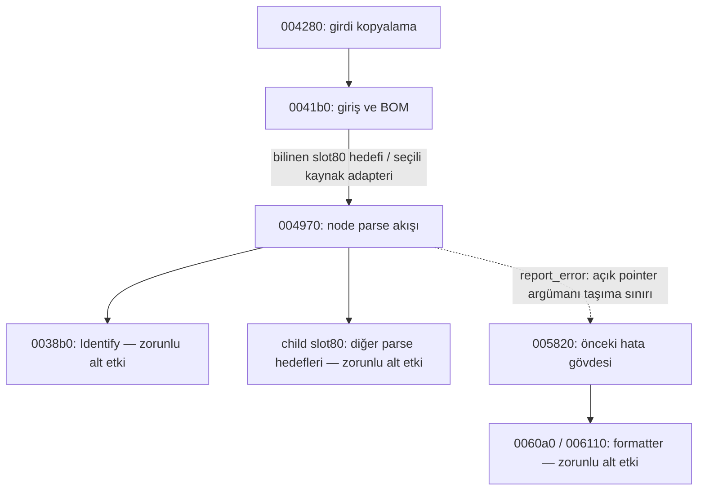

# N25 — 0x180004970 node parser kaynak gövdesi

26 Ekim 2026. `node_parse.hpp/cpp`, `parse_node_004970` normal byte-state gövdesini ve `RecoveredNodeParseEffects` seçili kaynak adapterini ekler. Sadece bilinen 004970 hedefi kaynak gövdesine gider; diğer hedefler mandatory `parse_other_virtual` sağlayıcısında kalır. Bu bir generic parser kapanışı veya tam DOM yeniden oluşturması değildir.

## Kimlik ve kanıt

Anadius64 SHA-256: `9e420c3aae5ea26410f0bf578f86c47e51e36ff770b9e2a28b5eaee46aed786c`. REA 6.5.0 server/catalog kimliği ve kullanılabilir Ghidra checkpoint'i `node-parse-rea-session.json` içindedir. Bu aşama yeni binary import/data read gerçekleştirmez; kayıtlı kanıtları kullanır.

| Yordam | Assembly Evidence | Pseudocode Evidence |
|---|---|---|
| 0x180004970 | `ev_bab15aa72d1d1d2cb34f0a417872877e60c9e43b5b9530ac83290c1bbc58da0a` | `ev_01d06f0d09c426e84edfc80412a5b90481296b9b16734298cadd2cf8fceab53d` |

Önceki N24 kaydı 004970 için `module_record_only`, sıfır definition, uncompiled ve normal-claim false idi. Bu aşama yalnız bu bucket'ı `source_definition_mapped` yapar; `no_definition_mapping` değişmez. Yeni tek numeric tanım `parse_node_004970`'tir. Adapterin `parse_virtual`/`parse_child_virtual` yöntemleri ikinci native gövde veya numeric variant sayılmaz. Historical typed provider closure 44 olarak korunur; yeni ayrı `node_parse_source_adapters` listesi bir seçili adapteri kaydeder. Önceki iki semantic session adapter ve ayrı allocation adapter korunur.

0041b0, 004280, 005820, 0038b0, 003aa0, 0035e0 ve 05c550 yalnız context olarak eklenir; bu aşamada yeni native recovery sayılmaz.

## Derinlik ve giriş

Decompiler üç argüman gösterse de `004989/00498c`, R9 line-counter adresi ve R8 optional output StrPair adresini ayrı korur. Kaynak dört gözlenen argümanı ve açık mapped invocation scratch'ını taşır. `004995` owner+8 document kimliğini cache eder; `00499e` DWORD doc+a4 sayacını artırır. Yalnız yeni değer **100'e eşitse** error18 çağrılır (`0049c3`); `>=100` kontrolü eklenmez. Hata sonrası owner+8 canlı olarak yeniden okunur. Normal epilog `004e77` ilk cache edilen document+a4 sayacını azaltır; callback'lerin document pointer'ını değiştirmesi bu hedefi değiştirmez. Mapping/lower exception için yapay RAII decrement veya rollback yoktur.

## Ayrıştırma ve çağrı ilişkileri

| Adres | Korunan akış |
|---|---|
| 0049cf–004a03 | İlk live error/null/NUL kontrolü; out-node sıfırlama; Identify0038b0 cursor ve out-node ayrı sonuçları |
| 004a1c–004a43 | Child satırını cache etme; local StrPair flags/start/end reset, padding korunur; child live vtable+80 parse ve R9 line-counter adresi |
| 004a5b–004aa6 | Declaration/owner/first/last probe kısa devreleri; çağrılar önceden tek bool'a indirgenmez |
| 004ab2–004b28 | Element probe, mode ve local closing alanları; materialize0035e0 ve pointer-eşitlik bypass sonrası compare05c550 limit0x7fffffff |
| 004b3e–004b8d | Aynı live document için prepare003aa0; ardından live last-child üzerinden ordered append; local owned string free; backedge yalnız input byte'ını kontrol eder |
| 004b97–004c40 | Invalid declaration error11, format080000 ve açık pointer-vararg; cached-tail-count cleanup |
| 004c45–004cf9 | Mismatch error14, format080018 ve açık pointer-vararg; live-tail-count cleanup |
| 004cff–004ddc | Mode2 output StrPair sahiplik aktarımı, pool track+20, live-tail-count cleanup; child next cursor dönüşü |
| 004de4–004e76 | Failed child parse cached-tail-count cleanup; live error sıfırsa error15; local pair cleanup |

Kesikli hata kenarı bir otomatik native varargs bağlantısı değildir; alt sağlayıcı uygun invocation bağlamını açıkça kurmalıdır. Diyagram statik çağrı ilişkilerini ve seçilen kaynak bileşimini gösterir; orijinal binary yürütme gözlemi değildir.

İlk girişteki error kontrolü her loop başında tekrarlanmaz; success backedge 0049e1 yalnız current input byte'ına döner. Identify'nin ayrı cursor sonucu, out-node yokken başarı return'üne dönüştürülmez. Normal EOF/null/failure sonucu0'dır; mode2 closing yolu child next cursor'unu döndürür.

## Temizleme ve sahiplik ayrıntıları

Dört child cleanup yolu benzer görünse de tek helper'a kör yönlendirilmez. Failed child parse ve declaration error başlangıç signed count'unu hem arama sınırı hem replacement tail için cache eder. Mismatch ve mode2 closing arama sınırını cache eder, replacement tail count'u live signed DWORD'den yeniden okur. Index32 increment/sign-extension, swap sonrası live count decrement, destructor öncesi cache edilen pool ve destructor sonrası live pool release target korunur.

Mode2 closing output pair null veya source pair ile aynıysa move atlanır. Diğer durumda output owned-start free edilir; output flags/start/end reset olur, source alanları sıralı taşınır, source üç alanı sıfırlanır. Bu ownership move işlemidir; string kopyası değildir. Padding ve alias sırası korunur.

N24 `set_error_005820` helper'ı native caller varargs yakalamaz. N25 `report_error` etkisi error11/error14 için bir pointer argümanını açıkça taşır; lower sağlayıcı N24 gövdesini kullanmadan önce doğru invocation bağlamını kurmak zorundadır. Error18 formatında conversion yoktur; error15 detail0'dır. Local out-node ve StrPair alanları için `acquire_parse_scratch` mandatory kalır; bu native stack ABI'ı değildir.

## Retained veri

`node-parse-retained-data.json`, tam historical read `ev_1585c277e2b5dffb5a54c26a1db122db985c13d72fea8b0b6272dbea69b9b082` kaydını kullanır. Parent SHA-256 `c6d1daab6e5cce17f48285d07f7b7a1f6c9be4b37f043f19694009393b401495`; aralık 0x18007f000..0x1800a0dff, 138752/138752 byte complete'tir. Üç exact NUL-sonlu sabit doğrulanır: 080000 `XMLDeclaration value=%s`, 080018 `XMLElement name=%s`, 080098 `Element nesting is too deep.`. Document vtable 07fec8 slot+80 adresi 07ff48, exact `7049008001000000` baytlarıyla 004970 kimliğini verir. Bu initialized static Ghidra memory kanıtıdır; runtime çağrı gözlemi değildir. Başka child hedeflerinin kimliği veya gövdesi bu slot'tan çıkarılmaz.

## Doğrulama ve açık sınırlar

**198 çekirdek + 42 entegrasyon = 240 yeni kontrol PASS**. Authoritative ortak build grupları `socket_node_parse`/`socket_node_parse_integration` olur. Module standalone script bu aşamada çalıştırılmış sayılmaz. Bağımsız sınırlı statik review üretim cpp/hpp hash'lerine bağlıdır; full native equivalence review tamamlanmış sayılmaz.

Ortak build: 206 üretim nesnesi (202 C++ / 4 C), 225 normal + 19 terminal grup, 98 socket grubu. Önceki 666 kaynak/CRT byte olarak korunur; 671 source ve 239 documentation snapshot girdisi vardır. 49 validation mirror = 48 historical + bir current; 96 historical config referansı, 154 dependency hash. Historical typed closure 44 olarak kalır; bir ayrı node-parse seçili adapteri kaydedilir. Bu sayılar DLL tamamlanma yüzdesi değildir.

Identify0038b0, GetStr0035e0, prepare003aa0, compare05c550, heterojen child parse/probe/destructor/pool gövdeleri, explicit error-argument transport, mapped scratch, heap/formatter/classifier/native ABI/EH/concurrency ve tam DOM açık kalır. Original DLL/oyun yürütülmez/değiştirilmez; gerçek CFG/token/achievement içeriği okunmaz. Hash-only integrity ayrıdır. Önceki engelli version.dll/generated DLL tekrar okunmaz veya koruma ayarları değiştirilmez.

Öncelik 1→2→3→5→4; genel CRT aşama 5 beklemede. Sıradaki N26, kayıtlı 0x1800038b0 Identify yordamının envanter ve sözleşme incelemesidir; hazırlık yeni Identify gövdesi sayılmaz.
